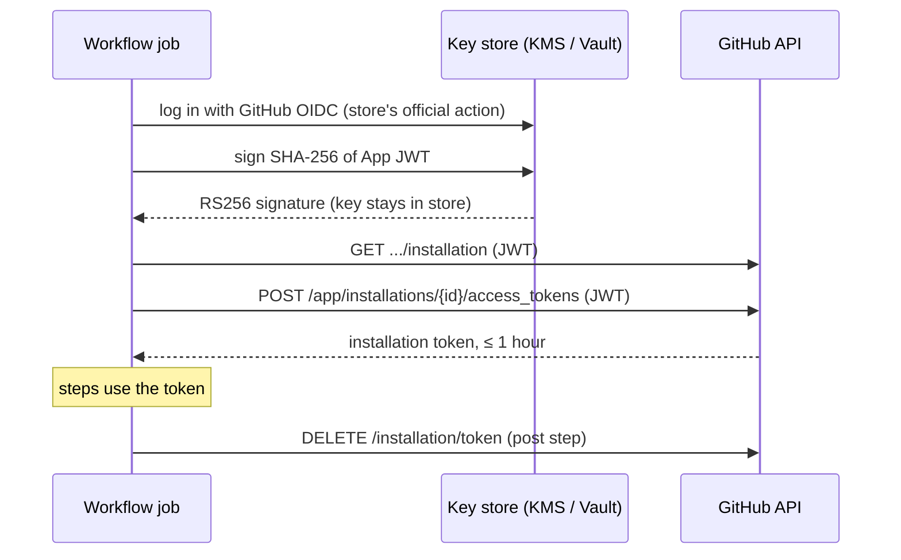

# app-token-signer

Create a GitHub App installation token in GitHub Actions while the App's private key stays in GCP Cloud KMS, AWS KMS, Azure Key Vault or HashiCorp Vault / OpenBao Transit.

## Why

The `GITHUB_TOKEN` a workflow gets reaches only its own repository, and pushes or pull requests made with it start no workflow runs. It cannot read another private repository, manage organization teams, or change files under `.github/workflows`. A GitHub App installation token can.

Minting that token needs the App's private key. Kept as an Actions secret, the key is readable by every step of every workflow that uses the secret, and a leaked copy mints tokens until someone deletes it on GitHub. Here the key never leaves the key store: CI can only ask the store to sign, as the workflow's OIDC identity, and every signature is logged.

## How it works



GitHub verifies the JWT with the public key it already holds and cannot tell it from a PEM-signed one.

## Usage

```yaml
permissions:
  id-token: write

steps:
  - uses: google-github-actions/auth@<sha> # v3
    with:
      workload_identity_provider: projects/123/locations/global/workloadIdentityPools/github/providers/github
  - id: app-token
    uses: nhkhai-vn/app-token-signer@<sha> # v0.1.1
    with:
      client-id: ${{ vars.APP_CLIENT_ID }}
      key: ${{ vars.APP_KEY }}
      permission-contents: write
  - run: gh pr list
    env:
      GH_TOKEN: ${{ steps.app-token.outputs.token }}
```

`key` names the key and its version:

| Store | `key` |
|---|---|
| GCP Cloud KMS | `gcp-kms://projects/P/locations/L/keyRings/R/cryptoKeys/K/cryptoKeyVersions/V` |
| AWS KMS | `aws-kms://arn:aws:kms:REGION:ACCOUNT:key/KEY_ID` or `…:alias/NAME` |
| Azure Key Vault | `azure-kv://VAULT.vault.azure.net/keys/KEY/VERSION` |
| Vault / OpenBao Transit | `vault-transit://MOUNT/keys/KEY?version=N` |

Other inputs: `client-id` (or `app-id`), `owner`, `repositories`, `enterprise`, `skip-token-revoke`, `github-api-url` and one `permission-*` per App permission. Outputs: `token`, `installation-id`, `app-slug`.

## Setup

Import the App's private key into your store, let only this repository sign with it, then delete the PEM. Commands per store, the event binding that stops `pull_request_target` runs from signing, and key rotation: [docs/setup.md](docs/setup.md).

## Limits

The job is the trust boundary: every step in it can read the token, so keep third-party actions out of that job. Whoever may sign may request any permission the App has.

## Pinning

Pin by full commit SHA. `gh attestation verify dist/main.cjs -R nhkhai-vn/app-token-signer` checks that `dist/` at that commit was built from its source by the release workflow.

## Development

```sh
npm ci
npm run type-check && npm run lint && npm test && npm run build
docker run -d -p 8200:8200 -e VAULT_DEV_ROOT_TOKEN_ID=root hashicorp/vault:2.1.2
VAULT_ADDR=http://127.0.0.1:8200 VAULT_TOKEN=root npm run test:integration
```

`dist/` is committed and CI fails when it differs from a fresh build. `npm run gen:action` regenerates the `permission-*` inputs in `action.yml`.

## License

[Apache-2.0](LICENSE)
